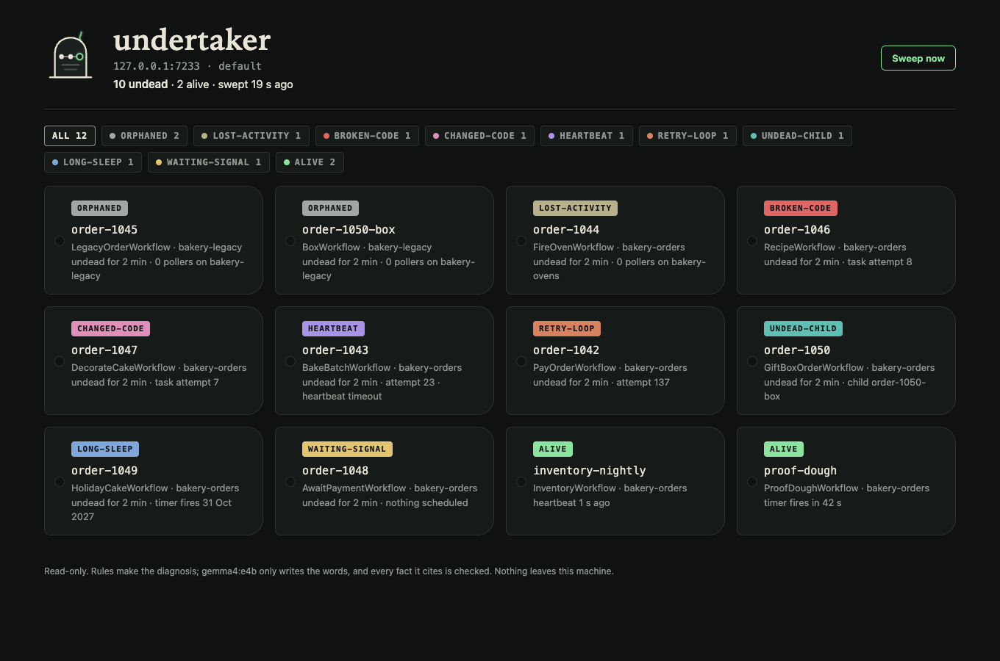
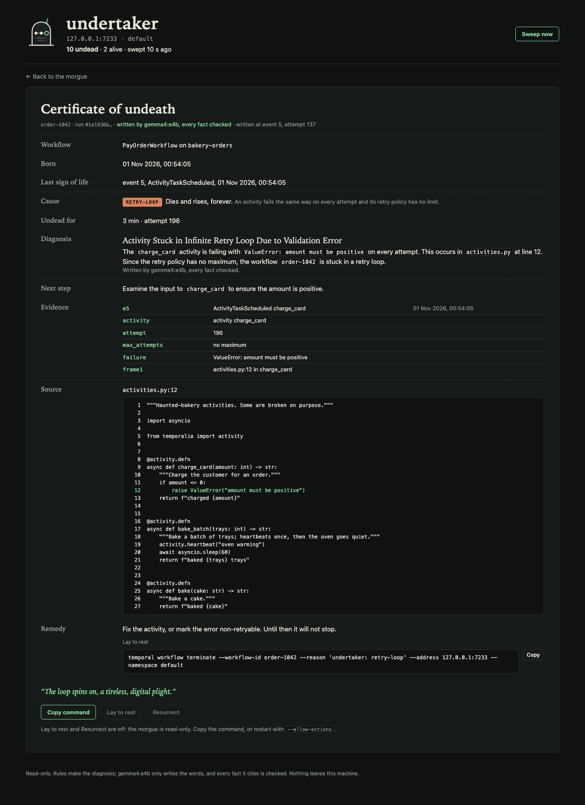
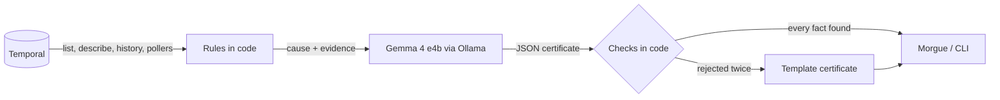

<p align="center"></p>

# undertaker

Finds the Temporal workflows that will never finish, and tells you why. It sorts every running workflow into a cause using Temporal's own data, then writes a checked **certificate of undeath** for each one with Gemma 4 running locally through Ollama.



## Why local

Workflow histories hold real payloads (orders, customers, card errors), and stack traces point into private code. Sending them to a hosted model to ask "why is this stuck" is the thing most teams can't do. A 4B model on your own machine can. Undertaker talks to your Temporal server and to Ollama on localhost, and nothing else: no telemetry, no CDN, no web fonts.

## 60-second start

You need macOS with Homebrew, `uv`, the Temporal CLI (`brew install temporal`) and, for model certificates, Ollama with `gemma4:e4b`.

```sh
uv sync
uv run undertaker demo up        # local dev server + a worker full of broken bakery workflows
uv run undertaker sweep --demo   # wait ~30 s first, for the demo thresholds
uv run undertaker serve --demo --source src/undertaker/demo   # http://127.0.0.1:8666
uv run undertaker demo down      # stops everything it started
```

`--demo` only shortens the thresholds (`--quiet 20s --attempts 3`). `--source` lets certificates quote the lines around each stack frame.



## How it works



1. **Code diagnoses.** A sweep lists running workflows, then reads `describe`, the history (cached by last event id) and the task-queue pollers. Fixed rules, in a fixed order, pick the cause and collect evidence: event ids, attempts, failures, stack frames, poller counts.
2. **The model explains.** Gemma gets the cause, the rule, the evidence and (with `--source`) about 30 lines around each frame inside your source folder. It answers in a JSON schema: headline, diagnosis, cited evidence keys, next step and an epitaph.
3. **Code checks the model.** Every cited key must exist; every number, file, `file:line`, code span and activity or signal name must appear in the evidence or the excerpt; no other cause may be named; no commands or URLs; lengths hold; the epitaph has no digits or identifiers. One retry with the reasons, then a plain template. The page always says which one you are reading.
4. **Commands come from code.** Every certificate shows the exact `temporal` command for the remedy. The model never writes commands.

## Causes of undeath

| Cause | Shown as | Rule |
|---|---|---|
| `orphaned` | No one is listening | Workflow task scheduled, never started, for longer than `--quiet`, and no poller on its task queue within `--poller-window` |
| `lost-activity` | Sent to a worker that never came | Activity scheduled for longer than `--quiet`, no poller on that activity's task queue |
| `broken-code` | Its own code keeps killing it | Workflow task attempt ≥ 2 and the last `WorkflowTaskFailed` is a plain error |
| `changed-code` | Its code changed while it slept | The same, but the failure is non-determinism (`TMPRL1100`) |
| `heartbeat` | Stopped breathing | Activity attempt ≥ `--attempts`, last failure a heartbeat timeout |
| `retry-loop` | Dies and rises, forever | Activity attempt ≥ `--attempts`, a real failure, no retry maximum in sight |
| `undead-child` | Waiting on an undead child | A pending child workflow that is itself undead |
| `long-sleep` | Asleep for a very long time | An open timer longer than `--long-sleep` |
| `waiting-signal` | Waiting for a visitor who never comes | Nothing pending at all and the last event older than `--quiet`; lists signal names from the worker's metadata query |
| `alive` | Alive | None of the above, with the reason ("heartbeat 3 s ago", "timer fires in 40 s") |

The first matching rule wins, in this order.

## Commands

```
undertaker sweep [--json]            table: id, type, cause, undead for, key fact
undertaker inspect <workflow-id>     the certificate as text
undertaker serve [--allow-actions]   the morgue on 127.0.0.1:8666
undertaker watch [--once]            sweep every minute; one macOS notification per new undead
undertaker demo up | down | status   local dev server + demo worker + scenarios
undertaker eval --demo               found / missed / false alarms, model accepted / fallback, seconds
undertaker doctor                    Temporal reachable, Ollama reachable, model present, versions
```

## Flags

| Flag | Default | |
|---|---|---|
| `--address` | `127.0.0.1:7233` | Temporal frontend |
| `--namespace` | `default` | |
| `--quiet` | `10m` | how long something may sit before it counts |
| `--attempts` | `5` | activity attempts before a retry counts as a loop |
| `--poller-window` | `2m` | how recent a poller must be |
| `--long-sleep` | `7d` | timers longer than this are a long sleep |
| `--source PATH` | none | folder with your workflow code, for excerpts |
| `--model` | `gemma4:e4b` | Ollama model |
| `--ollama` | `http://127.0.0.1:11434` | Ollama URL |
| `--no-model` | off | template certificates only |
| `--allow-actions` | off | `serve` only: enables Lay to rest (terminate) and Resurrect (reset), each with a confirm |
| `--every` | `30s` serve, `60s` watch | sweep interval |
| `--demo` | off | `--quiet 20s --attempts 3` |

Every flag has an `UNDERTAKER_*` environment variable (`UNDERTAKER_QUIET=5m`).

Undertaker is read-only unless you pass `--allow-actions`. The action endpoints also require a custom header, so another page in your browser can't trigger them.

## Limits

- Tested against the Temporal dev server and Python workers only. Other SDKs' stack traces are shown as text without source lookup.
- No Temporal Cloud, mTLS or API-key login yet.
- Rules are heuristics with thresholds; a slow but healthy workflow can look undead until the thresholds are tuned.
- Temporal keeps only the last failure of a retrying activity, so `retry-loop` can't prove every attempt failed the same way.
- `waiting-signal` can't know whether the signal is still coming; it says so.
- Poller info in Temporal lags a few minutes after a worker dies.
- `--source` reads only regular files inside the folder you give; it refuses `..` and symlinks out.

## Development

```sh
uv run ruff check && uv run ruff format --check && uv run pytest
uv run pytest -m temporal   # needs /opt/homebrew/bin/temporal
uv run pytest -m model      # needs Ollama with gemma4:e4b
```

Build notes, decisions and eval numbers: [docs/BUILD_LOG.md](docs/BUILD_LOG.md). Design: [docs/design/spec.md](docs/design/spec.md).

## License

MIT. See [LICENSE](LICENSE).

Built for Hacktoberfest 2026, the DEV [Open-Source AI Challenge, Week 4 "Ghost in the Machine"](https://dev.to/challenges/hacktoberfest-week4-2026-10-26).
