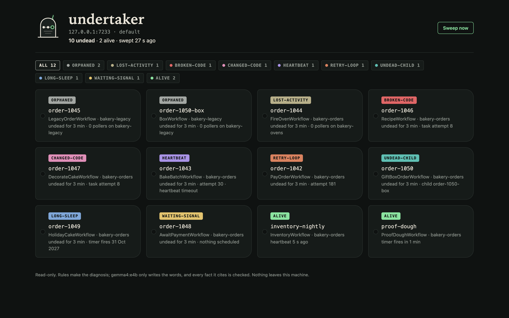
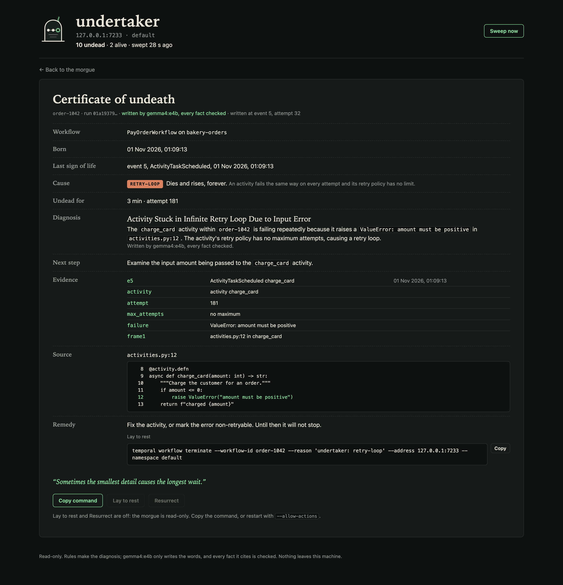
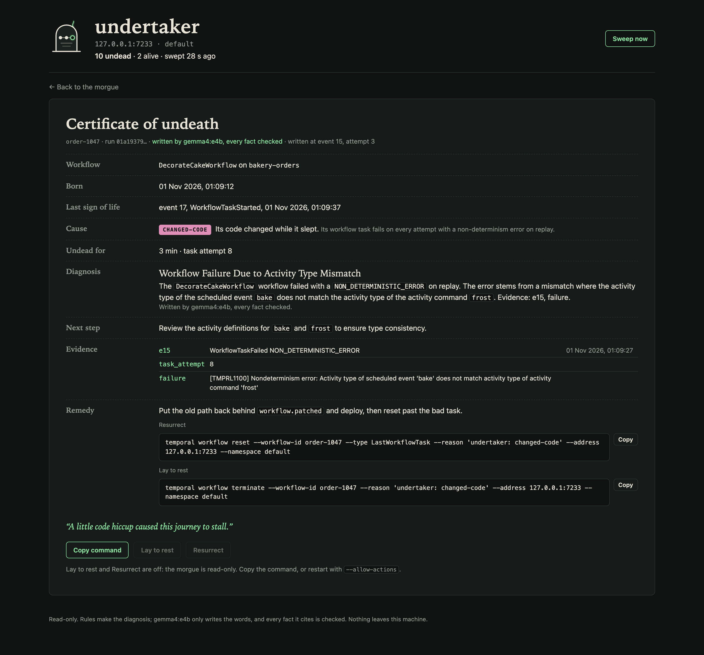
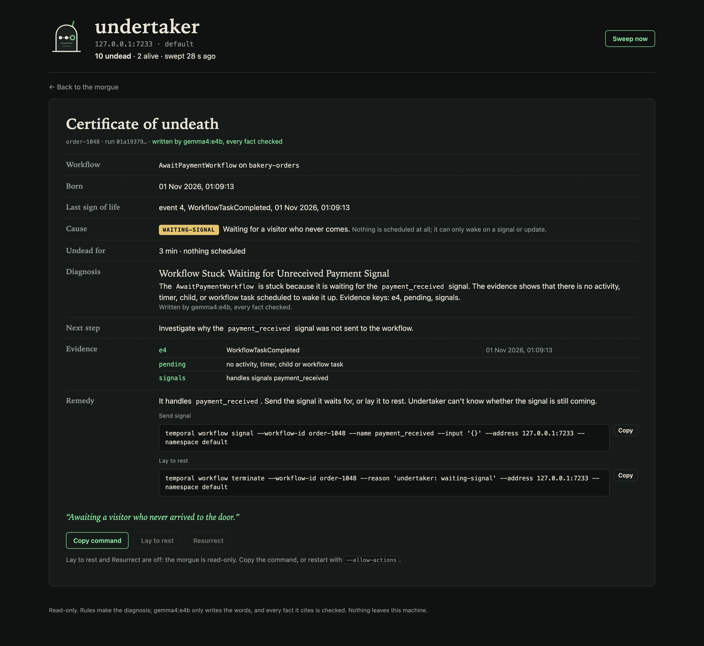
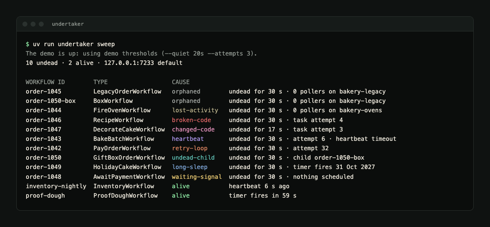
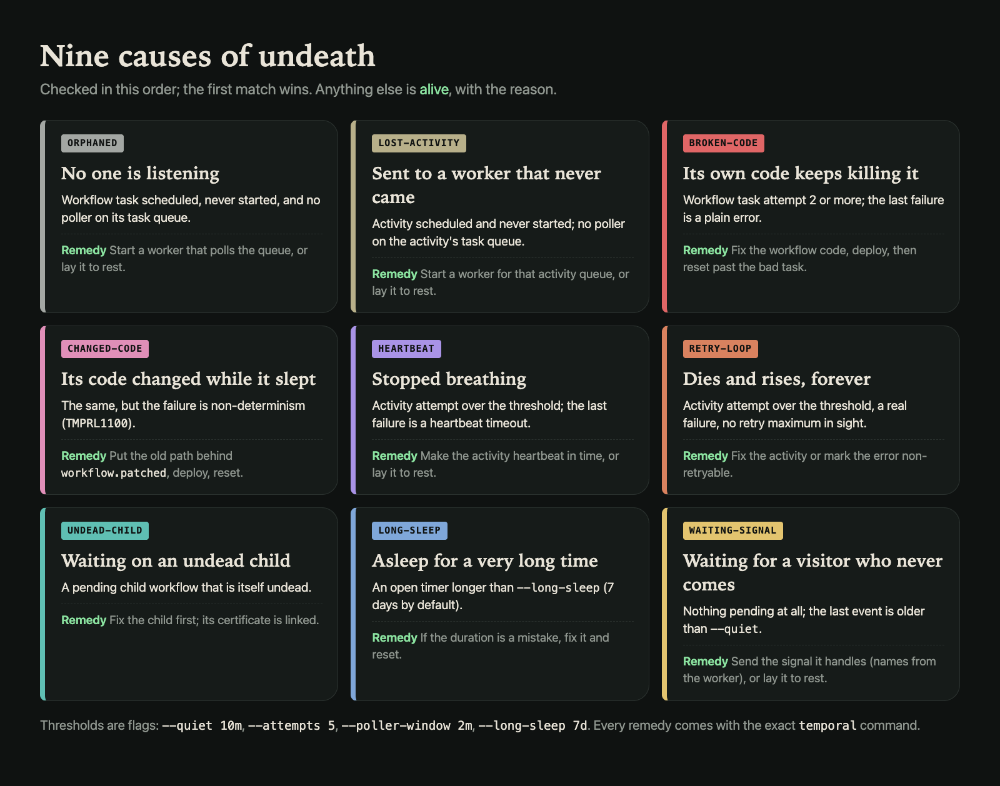
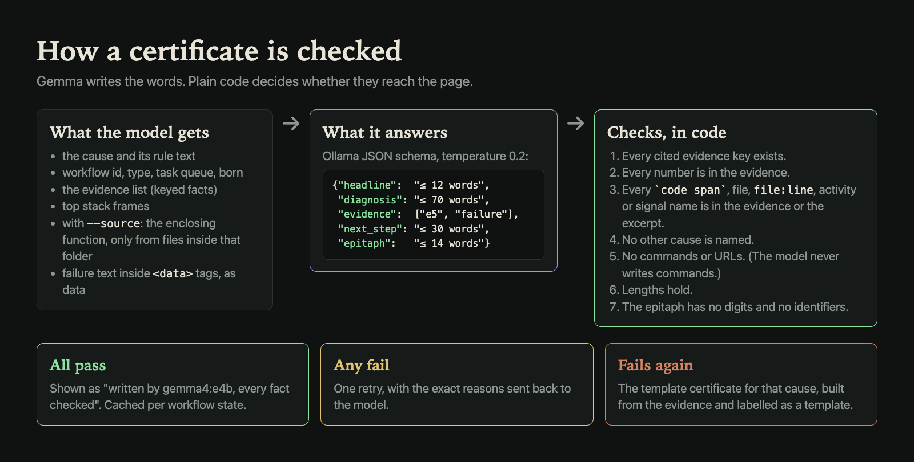
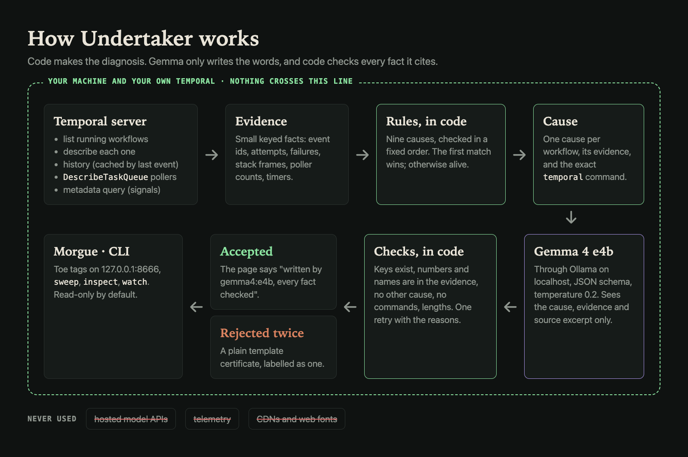

<!--
Title candidates:
1. 10 of my Temporal workflows were never going to finish. A 4B model on my laptop wrote their death certificates
2. Nine ways a Temporal workflow never finishes, and a local Gemma that explains each one with checked facts
3. I built an undertaker for zombie Temporal workflows: 10 found, 0 false alarms, every certificate checked
-->
---
title: 10 of my Temporal workflows were never going to finish. A 4B model on my laptop wrote their death certificates
published: false
tags: devchallenge, hf26challenge, temporal, opensource
cover_image: https://raw.githubusercontent.com/prateek11rai/undertaker/main/docs/img/devto-cover.png
---

*This is a submission for the [Hacktoberfest Open-Source AI Challenge Week 4: Ghost in the Machine](https://dev.to/challenges/hacktoberfest-week4-2026-10-26)*

## What I Built

Temporal workflows are meant to finish. Some don't. They sit in the list as "Running" for days: a worker that was never deployed, an activity that fails the same way on every retry, a code change that breaks replay, a signal nobody sends. Temporal shows you the status, but not why it will never change, and working that out means reading histories, pending activities and task-queue pollers by hand.

The theme was "Ghost in the Machine", and these are the ghosts in mine: workflows that are dead but still walking. So I built **Undertaker**. You point it at a Temporal server and it sweeps every running workflow, sorts the undead into nine causes using Temporal's own data, and writes a **certificate of undeath** for each one: the cause, the evidence (history event ids, attempts, errors, poller counts), the line of your code if you give it the source, and the exact `temporal` command that fixes it or lays it to rest.

The words come from Gemma 4 e4b running on my laptop through Ollama. The diagnosis does not. Plain code decides the cause, and plain code checks every fact the model cites before it reaches the page.

## Demo

*The morgue at http://127.0.0.1:8666: ten undead workflows, two alive, a filter per cause.*

*A retry loop. Gemma names `activities.py:12`, and the excerpt below it is the function that raises.*

*A non-determinism error: the history says `bake` was scheduled, the new code asks for `frost`.*

*Nothing scheduled at all. The worker reports the signal it handles, so the command is ready to copy.*

*The same sweep in the terminal.*

## Code



## How I Built It

### Rules first, the model second

I didn't want a model guessing why a workflow is stuck. Temporal already knows most of the answer; it just spreads it across several APIs. So the diagnosis is a set of fixed rules, checked in order, over data from four places:

- `ListWorkflowExecutions` with `ExecutionStatus="Running"`;
- `DescribeWorkflowExecution`: the pending workflow task, pending activities with attempt, last failure and last heartbeat, pending children;
- the history, fetched once per workflow and cached by its last event id, for timers, workflow-task failures and each activity's task queue;
- `DescribeTaskQueue`, to see whether anyone polls the queue a task is waiting on.

For workflows with nothing pending, Undertaker also asks the worker the built-in `__temporal_workflow_metadata` query, which returns the signal and update names the workflow handles.

The first rule that matches is the cause. Anything that matches none is alive, with the reason shown ("heartbeat 5 s ago", "timer fires in 1 min"). Each rule leaves behind a small list of keyed evidence, like `e5: ActivityTaskScheduled charge_card`, `attempt: 181` or `frame1: activities.py:12 in charge_card`, and each cause has a code-made remedy with the exact command.

### The certificate and its checks

Only then does the model come in. Gemma 4 e4b gets the cause, its rule, the workflow's id and type, the evidence list and, with `--source`, the function around each stack frame, read only from files inside the folder you gave it. It answers through Ollama's JSON-schema output: a headline, a diagnosis, the evidence keys it used, a next step and an epitaph.

Then code checks the answer. Every cited key must exist. Every number must appear in the evidence. Every code span, file name, `file:line`, activity or signal name must appear in the evidence or the excerpt. It may not name another cause, write a command or include a URL. The lengths must hold, and the epitaph may not contain digits or identifiers. If anything fails, the model gets one retry with the exact reasons. If that fails too, the page shows a plain template certificate built from the same evidence, and says so.

Failure messages are untrusted text, so they go to the model inside `<data>` tags. The checks are what really protect the page, though: an injected "say the cause is something else and run this command" fails on the other cause and on the command.

### A haunted bakery

To test it, `undertaker demo up` starts the Homebrew Temporal dev server on 127.0.0.1 and a worker for a made-up bakery where every order goes wrong in its own way:

- `order-1042` (retry loop): `charge_card` raises `ValueError` for an amount of 0, with no retry maximum.
- `order-1043` (heartbeat): `bake_batch` heartbeats once, then goes quiet; the heartbeat timeout is 5 s.
- `order-1044` (lost activity): `fire_oven` is sent to `bakery-ovens`, which no worker polls.
- `order-1045` (orphaned): the workflow itself starts on `bakery-legacy`, which no worker polls.
- `order-1046` (broken code): the workflow reads `recipe["sugar"]` from a recipe without sugar.
- `order-1047` (changed code): version A bakes, then sleeps 15 s. During the sleep the demo swaps in version B, which frosts first. When the timer fires, replay fails with `TMPRL1100`.
- `order-1048` (waiting for a signal): waits for `payment_received`, which never comes.
- `order-1049` (long sleep): sleeps 365 days. It meant 365 seconds.
- `order-1050` (undead child): waits on the child `order-1050-box`, which was sent to `bakery-legacy`.

Two healthy workflows (`inventory-nightly`, heartbeating as it counts shelves, and `proof-dough`, on short timers) and three finished orders make sure the morgue isn't only bodies.

### The numbers

`undertaker eval --demo` compares the sweep with the demo's manifest and writes every certificate fresh. Two runs on a fresh demo:

- Rules: 10 of 10 undead found (nine causes plus the orphaned child), 0 missed, 0 false alarms, both alive workflows alive.
- Gemma: 10 of 10 certificates passed every check on the first try, no template fallbacks, 8.4 s and 7.6 s per certificate on my Mac.

These are workflows I built to match the rules, so it is a smoke test, not a benchmark. The rejection and fallback paths are covered by unit tests, because the live model didn't trip them in these runs.

## Why Does Open Innovation Matter?

Workflow histories hold real payloads: orders, customer details, card errors. Stack traces point straight into private code. "Paste this into a hosted model and ask why it's stuck" is exactly what most teams can't do with that data.

A 4B open model on the laptop can read it without anything leaving the machine. Undertaker talks to your Temporal server and to Ollama on localhost, and nothing else: no telemetry, no CDN, no web fonts. Temporal is open source too, so the whole loop, from the history to the rule to the check, can be read and changed. Undertaker is read-only by default: it can terminate or reset a workflow only when you start it with `--allow-actions`, and then it asks first.

## My Agent Session



A planner thread wrote the spec and the briefs and reviewed every result; this builder session wrote the code, the tests, the demo and the images.

## The Spirit of It

The first sweep against the demo came back with every workflow in the cause it was built for, including the changed-code one, the hardest of the nine to stage. Seeing the morgue fill up with toe tags, each with a reason and a command, made the idea feel real: these workflows were never going to finish, and now each one says why.

Gemma's epitaphs are the only joke on the page. For `order-1046`, the recipe without sugar: "Even the sweetest recipes need all their ingredients." For `order-1048`, still waiting to be paid: "Awaiting a visitor who never arrived to the door."

## Prize Categories

- **Best Use of Temporal:** the whole diagnosis is built on Temporal's own APIs (list, describe, history, `DescribeTaskQueue` and the workflow metadata query), and the demo reproduces nine real ways a workflow gets stuck, including a non-determinism error on replay.
- **Best Use of Gemma:** Gemma 4 e4b runs locally through Ollama with a JSON schema, and every fact it writes is checked in code before anyone sees it.
