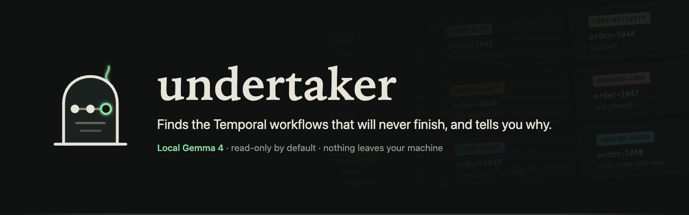

# undertaker v0.1.0

The first release. Undertaker finds the Temporal workflows that will never finish and writes a checked certificate of undeath for each one, with Gemma 4 running on your own machine.



## What it does

- **Sweeps** every running workflow in a namespace: `describe`, the history (cached by last event id), `DescribeTaskQueue` pollers, and the worker's metadata query for signal names.
- **Diagnoses in code.** Nine rules, in a fixed order, put each workflow into a cause and collect the evidence: event ids, attempts, failures, stack frames, poller counts, timers. Anything else is alive, with the reason.
- **Explains with Gemma 4 e4b** through Ollama on localhost, in a JSON schema: headline, diagnosis, cited evidence, next step and an epitaph.
- **Checks every fact** the model cites: evidence keys, numbers, names, files and lines, no other cause, no commands or URLs, lengths, and an epitaph with no digits or identifiers. One retry with the reasons, then a plain template. The page says which one you are reading.
- **Gives the exact command** for each remedy (`temporal workflow terminate`, `reset`, `signal`, `task-queue describe`), with your address and namespace filled in. The model never writes commands.
- **The morgue** on http://127.0.0.1:8666: one toe tag per workflow, filters per cause, certificate pages with evidence, source excerpts and copy buttons.
- **CLI:** `sweep`, `inspect`, `serve`, `watch` (one macOS notification per new undead), `eval`, `doctor`, `demo up | down | status`.

## The demo in 60 seconds

```sh
uv sync
uv run undertaker demo up      # Homebrew Temporal dev server + a worker full of broken bakery workflows
uv run undertaker sweep        # after ~30 s
uv run undertaker serve --source src/undertaker/demo
uv run undertaker demo down
```

The haunted bakery has one zombie per cause, an orphaned child, two healthy workflows and three finished orders. All of it is made up.

## Causes of undeath

| Cause | Shown as |
|---|---|
| `orphaned` | No one is listening |
| `lost-activity` | Sent to a worker that never came |
| `broken-code` | Its own code keeps killing it |
| `changed-code` | Its code changed while it slept |
| `heartbeat` | Stopped breathing |
| `retry-loop` | Dies and rises, forever |
| `undead-child` | Waiting on an undead child |
| `long-sleep` | Asleep for a very long time |
| `waiting-signal` | Waiting for a visitor who never comes |

## Read-only by default

Pointing Undertaker at a server changes nothing. Lay to rest (terminate) and Resurrect (reset) exist only in `serve --allow-actions`, each behind a confirm and a custom request header. Everything listens on 127.0.0.1; no telemetry, CDN or web fonts.

## Measured

`uv run undertaker eval --demo --source src/undertaker/demo`, two runs on a fresh demo, Apple Silicon Mac, `gemma4:e4b` on Ollama 0.35.1:

- Rules: 10/10 undead found, 0 missed, 0 false alarms, 2/2 alive.
- Gemma: 10/10 certificates accepted on the first try, 0 template fallbacks, 8.4 s and 7.6 s per certificate.

These are ten workflows built on purpose, so this is a smoke test, not a benchmark.

## Limits

- Tested against the Temporal dev server and Python workers only.
- No Temporal Cloud, mTLS or API-key login yet.
- Rules are heuristics with thresholds; tune `--quiet`, `--attempts`, `--poller-window` and `--long-sleep` for your system.
- Temporal keeps only the last failure of a retrying activity, so `retry-loop` can't prove every attempt failed the same way.
- `waiting-signal` can't know whether the signal is still coming.
- Poller info lags a few minutes after a worker dies.

## Credits

Temporal (server, CLI and Python SDK), Gemma 4 via Ollama, FastAPI, Uvicorn, Jinja2 and Pydantic. Built for the DEV Hacktoberfest Open-Source AI Challenge, Week 4: Ghost in the Machine. MIT licence.
